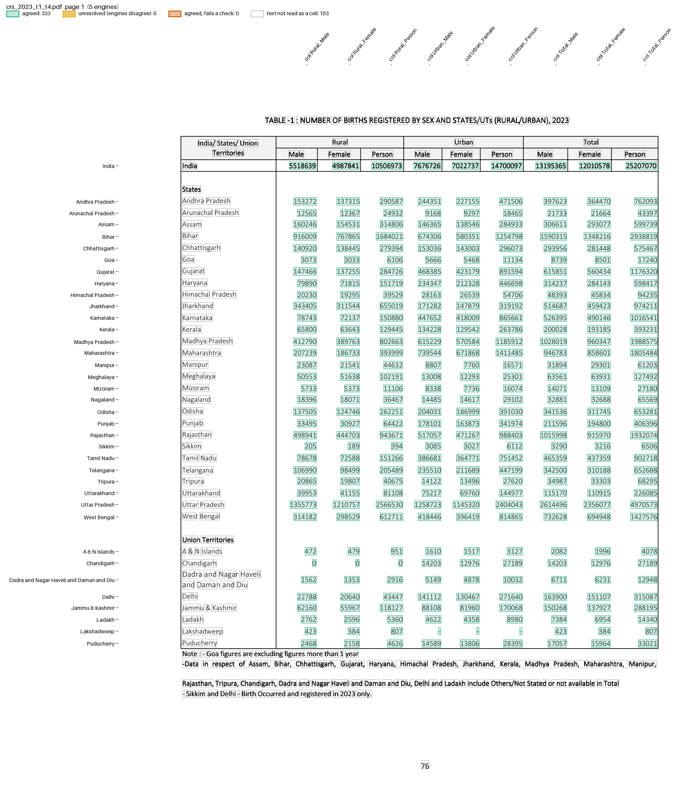

# CRS State and District Tables

The annual Civil Registration System (CRS) report prints four State/UT tables of one shape: registered births, deaths, infant deaths and still births. Each row is a State/UT, then Male, Female and Person for Rural, Urban and Total.

The files are in `examples/crs_state_tables/`: `recipe.toml` and `crs_state_table.py`. The fixture holds Table 1 and Table 4 of the 2023 report, in `tests/fixtures/crs/`.

## The recipe

```toml
name = "CRS State Tables 1-4"

[pages]
match = 'TABLE\s*-?\s*[1-4]\s*:\s*NUMBER OF .{0,30}REGISTERED BY SEX'

[engines]
ocr = false  # a text layer: the five default engines, 3 must agree

[parser]
type = "custom"
function = "crs_state_table.py:parse"
key = ["page", "state", "col"]

# ">=" because some States count Others/Not stated only in Person or Total
[[checks]]
column = "sex"
rule = "Person >= Male + Female"
by = ["page", "state", "area"]

[[checks]]
column = "area"
rule = "Total >= Rural + Urban"
by = ["page", "state", "sex"]

[output]
layout = "table"
rows = ["page", "label"]  # one row per table and State/UT
columns = "col"           # Rural_Male ... Total_Person
format = "csv"
```

`match` keeps only the four table pages of a full report. The parser reads rows as the generic parser does, then names each value's `area` and `sex`, so the checks can use them.

`parse()` in `crs_state_table.py`, in outline (pseudocode):

```text
def parse(pages):
    for page_no, lines in pages:
        seen = set()
        for label, values in lines split into text and values:
            skip a line without exactly 9 values
            no label: take the text lines just above and below, if they have no values
            state = the label in lower-case letters; skip it if seen on this page
            for col, value in zip(Rural_Male ... Total_Person, values):
                yield {"page", "state", "col", "label", "area", "sex", "value"}
```

## Run it

```bash
pdfexorcist extract tests/fixtures/crs/crs_2023_t1_t4.pdf --recipe examples/crs_state_tables/recipe.toml -o crs_2023.csv
```

```
  pdftotext   666 readings  0.0s
  pdfplumber  666 readings  0.4s
  pymupdf     666 readings  0.0s
  camelot     666 readings  2.5s
  pdfium      666 readings  0.0s

Agreed          666  100.0% of cells
Unresolved        0
Checks      2 rules  all passed
```

```
page,label,Rural_Male,Rural_Female,Rural_Person,Urban_Male,Urban_Female,Urban_Person,Total_Male,Total_Female,Total_Person
1,India,5518639,4987841,10506973,7676726,7022737,14700097,13195365,12010578,25207070
1,Andhra Pradesh,153272,137315,290587,244351,227155,471506,397623,364470,762093
1,Arunachal Pradesh,12565,12367,24932,9168,9297,18465,21733,21664,43397
...
1,Dadra and Nagar Haveli and Daman and Diu,1562,1353,2916,5149,4878,10032,6711,6231,12948
1,Lakshadweep,423,384,807,-,-,-,423,384,807
```

`pdfexorcist show tests/fixtures/crs/crs_2023_t1_t4.pdf --recipe examples/crs_state_tables/recipe.toml -o page.png` draws what the recipe reads:



## What is unusual

* The India row is printed in fake bold: each glyph is drawn four times, about 0.25 pt apart. The engines drop a copy of a word or glyph that lies within 1.5 pt of another, so they read the row once.
* "Dadra and Nagar Haveli and Daman and Diu" wraps around its row, half above and half below. A row without a label takes the text lines on either side.
* camelot returns some rows a second time. A State is printed once a page, so the parser keeps its first row.

Every agreed value equals crsindia's PDF-verified data (`tests/test_crs_state_table.py`).

## Table 6: deaths by age group

`table6.toml` and `crs_state_t6.py` read the deaths table: a State's row (its All Ages total), then one row per age group. The table's number changes between reports (Table 5, 6 or 10), so `[pages]` matches `DEATHS? BY AGE AND SEX`. A third check adds the age groups up to the State's row, by State, because a State can run on to the next page:

```toml
[[checks]]
column = "age"
rule = "All Ages = rest"
by = ["state", "col"]
```

An age label holds numbers ("1 Year - 4 Year"), so the parser joins it into one cell before the values are placed. The values are placed by `parse_by_columns(placement="both")`: by their order and by their position, kept only where the two agree. In the 2010 report, "Not Available" is printed diagonally over the Rural and Urban cells of Andhra Pradesh, so its rows have only the three Total values. By order they are Rural, by position Total, so the cells are left for review.

```bash
pdfexorcist extract tests/fixtures/crs/crs_2023_t6_fakebold.pdf --recipe examples/crs_state_tables/table6.toml
```

```
Agreed          540  100.0% of cells
Unresolved        0
Checks      3 rules  all passed
```

## District Tables 7-10

`examples/crs_district_tables/` reads the district tables: a State's row, then its numbered districts; Table 7 adds the sex ratio at birth (SRB). The parser takes a row without a serial number as a State. A page that starts with district 5 goes on with the last page's State only when the last page ended at district 4; otherwise the State is not known (`""`). The third check is that a State's row is at least the sum of the districts read:

```toml
[[checks]]
column = "level"
rule = "State >= District"
by = ["table", "state", "col"]
where = "col != 'SRB'"
```

```bash
pdfexorcist extract tests/fixtures/crs/crs_2016_district_rotated.pdf --recipe examples/crs_district_tables/recipe.toml
```

```
Agreed        1,047  98.0% of cells
Unresolved       21  engines disagreed: left blank
Checks      3 rules  all passed
```

The 2016 pages print "Not Available" at 45 degrees over blank cells. Before the engines read a page, pdfexorcist drops slanted text without digits, so it cannot join the rows it crosses. The unresolved cells are hidden "N.A." text under Manipur's blank rows, which the engines place in different lines.

In the 2017 report every glyph is in a Type3 font without a Unicode map, so the text engines read control codes (100.0 is `*++$+`). With tesseract installed, pdfexorcist reads each glyph from the words it is part of and gives the font a Unicode map, and the five engines vote as usual. The page titles are read the same way, so `[pages] match` finds the tables (`tests/fixtures/crs/crs_2017_type3.pdf`).
