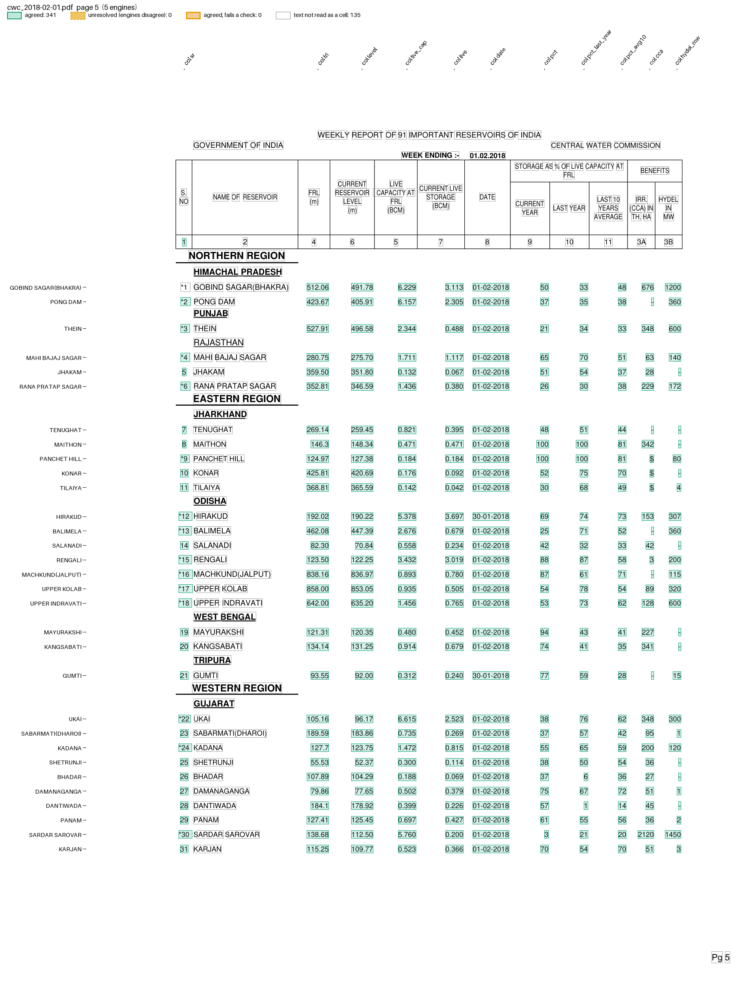

# CWC reservoir storage

The Central Water Commission (CWC) publishes a storage bulletin every Thursday for India's important reservoirs. Past bulletins are listed on its [reservoir storage bulletin page](https://cwc.gov.in/en/reservoir-level-storage-bulletin). Pages 1 and 2 are a brief note; page 3 gives storage by region and page 4 by basin. From page 5, each reservoir has a row under its region and state: serial number, name, FRL and today's level (m), live capacity at FRL and today's live storage (BCM), the date of the reading, storage as a % of live capacity this year, last year and the 10-year average, and the benefits: the irrigated area (CCA, culturable command area, in thousand ha) and the hydel power capacity (in MW). A star before the serial number marks a reservoir with more than 60 MW of hydel capacity.

The bulletin covers the whole country. Maharashtra's own daily dam report is [Pravah](pravah.md).

The files are in `pdfexorcist/recipes/cwc_reservoirs/`: `recipe.toml` and `cwc_reservoirs.py`. The fixture is the whole bulletin of 1 February 2018, in `tests/fixtures/cwc/`.

## The recipe

```toml
name = "CWC reservoir storage"

[engines]
ocr = false

[parser]
type = "custom"
function = "cwc_reservoirs.py:parse"
key = ["page", "id", "col"]

# the printed total for all reservoirs = the sum of the rows
[[checks]]
column = "id"
rule = "total = rest"
by = ["col"]
where = "col in ['live_cap', 'live']"
abs_tolerance = 0.0015

# this year's % = 100 * live / live capacity, rounded to a whole number
[[checks]]
function = "cwc_reservoirs.py:pct_of_live"

[output]
layout = "table"
rows = ["reservoir"]
columns = "col"
format = "csv"
```

`id` is the reservoir's name in lower case with spaces and punctuation dropped. The printed name, region, state and the hydel star are extra columns. The total row is `TOTAL FOR 91 RESERVOIRS` with the `PERCENTAGE` line below it.

## Run it

```bash
pdfexorcist extract https://cwc.gov.in/sites/default/files/01.02.2018cwcbull.pdf --recipe cwc_reservoirs -o cwc.csv
```

```
✓ pdftotext   1,006 readings  0.0s
✓ pdfplumber  1,006 readings  0.8s
✓ pymupdf     1,006 readings  0.1s
✓ camelot     1,006 readings  3.3s
✓ pdfium      1,006 readings  0.1s

✓  Agreed        1,006  100.0% of cells
   Unresolved        0
✓  Checks      2 rules  all passed

   Wrote   cwc.csv  92 rows, table layout
```

```
reservoir,region,state,hydel,sr,frl,level,live_cap,live,date,pct,pct_last_year,pct_avg10,cca,hydel_mw
GOBIND SAGAR(BHAKRA),NORTHERN,HIMACHAL PRADESH,*,1,512.06,491.78,6.229,3.113,01-02-2018,50,33,48,676,1200
PONG DAM,NORTHERN,HIMACHAL PRADESH,*,2,423.67,405.91,6.157,2.305,01-02-2018,37,35,38,-,360
...
ALMATTI,SOUTHERN,KARNATAKA,*,78,519.60,514.73,3.105,1.372,01-02-2018,44,22,33,@,290
...
SHOLAYAR,SOUTHERN,TAMIL NADU,*,91,1002.79,958.25,0.143,0.000,31-01-2018,0,0,15,-,95
TOTAL,,,,,,,161.993,69.887,,43,48,47,,
```

On the fixture:

```bash
pdfexorcist extract tests/fixtures/cwc/cwc_2018-02-01.pdf --recipe cwc_reservoirs
```

`pdfexorcist show tests/fixtures/cwc/cwc_2018-02-01.pdf --recipe cwc_reservoirs --page 5 -o page.png` draws what the recipe reads:



## The parser

`parse()` in `cwc_reservoirs.py`, in outline (pseudocode):

```text
def parse(pages):
    for page_no, lines in pages:
        skip the header, down to the column numbers "1 2 4 6 5 7 8 9 10 11 3A 3B"
        for line in lines:
            a star, serial, name, 4 numbers, a date, 3 percentages, CCA, MW -> a reservoir row
            "TOTAL FOR 91 RESERVOIRS" and 2 numbers                      -> the total capacity and storage
            "PERCENTAGE" and 3 numbers                                   -> the total's percentages; stop
            a line without digits ending in "REGION"                     -> the region
            any other line without digits                                -> the state
        each reservoir: yield {"page", "id", "col": sr ... hydel_mw, "value",
                               "reservoir", "region", "state", "hydel"} for each value
```

The region and state carry over to the next page.

## What is unusual

* The column numbers under the header run 1, 2, 4, 6, 5, 7, ... 11, 3A, 3B: the benefits (column 3) are printed last.
* Some CCA cells hold a footnote mark: `$` for the DVC system (Panchet Hill, Konar, Tilaiya), `@` for Almatti with Narayanpur, `#` for Aliyar with Parambikulam. The recipe keeps the mark as printed.
* Each reservoir has its own reading date; on the 1 February 2018 bulletin they run from 24 January (Jayakwadi) to 1 February.
* State headings are printed as on the page: `A.P & TG`, `CHHATTIS GARH`, `UTTRAKHAND`.
* Maithon and Panchet Hill are above FRL, at 100%.

`tests/test_cwc_reservoirs.py` runs the recipe on the fixture and compares every value with `tests/fixtures/cwc/expected.csv`, which was read from `pdftotext -layout` without the pipeline.
