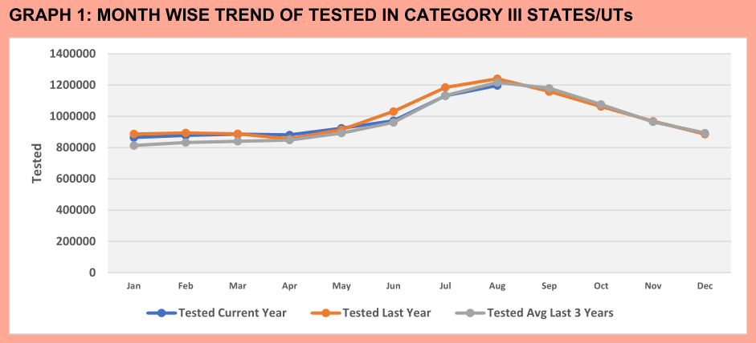

# NCVBDC line charts

The National Center for Vector Borne Diseases Control (NCVBDC) publishes a Monthly Malaria Situation report for each category of States/UTs. The [August 2026 Category III report](https://ncvbdc.mohfw.gov.in/WriteReadData/l892s/36403234541790767725.pdf) has 13 pages.

Two pages give four line charts for Category III and for each of its States: Mizoram, Odisha and Tripura. The four charts show Tested, Positive, TPR (positive cases for each 100 tests) and Pf (*Plasmodium falciparum* cases) by month. Each chart has three series: the current year, the last year, and the average of the last three years.

The charts do not show the values. Only the positions of the lines give the numbers.



The fixture contains the eight pages with charts (pages 3-4 and 7-12). It is in `tests/fixtures/ncvbdc/`. The example uses no recipe. The `charts` command reads the charts.

## Run it

```bash
pdfexorcist charts https://ncvbdc.mohfw.gov.in/WriteReadData/l892s/36403234541790767725.pdf -o charts.csv
```

On the fixture:

```bash
pdfexorcist charts tests/fixtures/ncvbdc/malaria_2026_08_cat3_charts.pdf -o charts.csv
```

```
Wrote 512 points from 16 charts to charts.csv.
```

```
page,chart,title,series,category,value,pm,status
1,1,GRAPH 1: MONTH WISE TREND OF TESTED IN CATEGORY III STATES/UTs,Tested Current Year,Jan,865002.0,1110.787589579386,estimated
1,1,GRAPH 1: MONTH WISE TREND OF TESTED IN CATEGORY III STATES/UTs,Tested Current Year,Feb,878335.0,1110.787589579386,estimated
...
4,1,GRAPH 3: MONTH WISE TREND OF TPR IN MIZORAM,TPR Current Year,Jan,1.361,0.007171776153575996,estimated
...
```

The current-year series stops at August, the month of the report. The other two series stop at December.

## How pdfexorcist reads the values

Excel draws each series as a line through its points, in the color of the series. The legend gives the name of each color.

The labels on the y axis give the scale. pdfexorcist moves each label to its gridline and finds the straight line through the labels. The position of a vertex on this scale gives the value of the point. The nearest month label gives its category.

A value from a position is an approximate value. `pm` gives the maximum error of the value. It is the change in value for 0.12 pt. In this report, the vertices of a line are a maximum of 0.12 pt from its markers. Each value has the status `estimated`.

The engines do not vote on these values. pymupdf, pdfplumber and pdfium read the same coordinates of the paths. Thus, an error in the data from one engine is also in the data from the other two engines.

Some charts for small areas show the axis labels `0 0 0 0 0 1 1 1 1 1`. Excel rounded the values 0, 0.1 ... 0.9 to integers. pdfexorcist finds the one Excel axis that gives these labels when Excel rounds them.

The step of this axis is 1, 2, 2.5 or 5 times a power of 10, and its first value is 0. If no axis gives the labels, or if more than one axis gives them, pdfexorcist does not read the chart. The output gives the chart and the cause.

pdfexorcist also does not read weekly lines below month labels.

## The checks

`tests/test_charts.py` compares the readings with the report:

* For each month of the current year and the last year, the TPR chart gives Positive / Tested × 100 from the other two charts. The difference is less than the `pm` limits. The test does not use the average series, because its TPR is an average of three TPR values.
* Positive / Tested × 100 for the year to date agrees with the TPR in the text below each TPR chart: Category III 0.62, Mizoram 3.44, Odisha 0.54 and Tripura 0.63. The difference is less than the `pm` limit plus 0.005, because the text gives two digits after the decimal point.

## In the browser

The site shows this report as an example. To read a different PDF in the same mode, select **What to read: Line charts**.

The page shows one table for each chart. Each table has a row for each series and a column for each month. The page also shows the `pm` of each chart. Its CSV file is the same as the CSV file from the command line.
